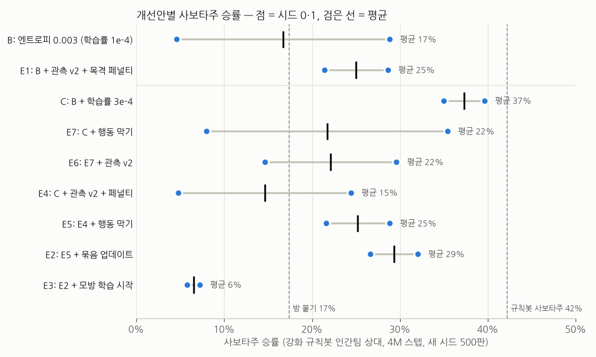
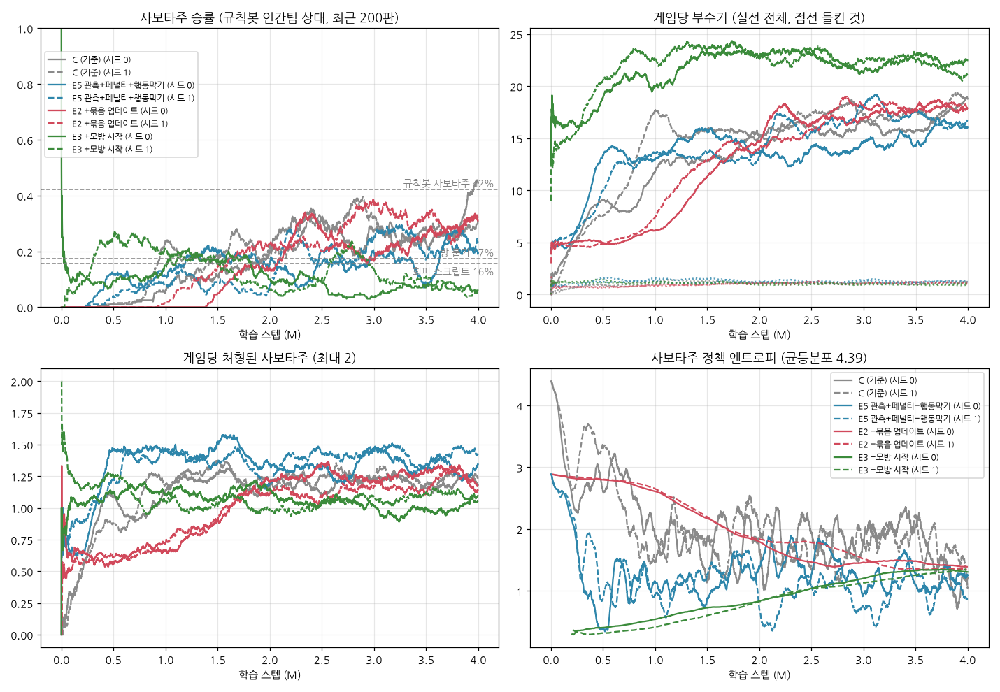

# 사보타주 승률 개선 실험 (1~4번 방안)

기준은 `../saboteur_vs_bot`이다. 거기서 학습 사보타주는 강화 규칙봇 인간팀을 41% 이겼다(8M, 최고 시드).
이번에는 승률을 더 올리려고 4가지 방안을 넣어 실험했다.

**결론: 4가지 모두 기준 설정(C)보다 높은 승률을 내지 못했다.** 최종 모델은 그대로 `models/saboteur_vs_bot_8M.pt`다.

## 출발점: 진단

최종 모델(41%)로 200판을 돌려 확인했다 (`eval/diag_*.py`).

| 항목 | 값 |
|---|---|
| 지는 판 가운데 처형으로 끝난 비율 | 약 60% (처형 72판, 도착 49판) |
| 부수기를 시작한 순간 인간팀이 시야 안에 있던 비율 | 7% |
| 목격된 사보타주 | 판당 1.6명, 그중 74%가 처형됨 (목격 후 중앙값 18.8초) |
| 이미 알림이 뜬 방에서 시작한 부수기 | 42% |

가설은 이렇게 세웠다.
- 사보타주의 관측에는 자기가 목격당했는지, 누가 함장이고 누가 동료인지가 없다.
- 그래서 들킨 뒤 18.8초 동안 함장을 피하지 못한다.

## 방안과 구현

| 번호 | 방안 | 구현 |
|---|---|---|
| 1 | 관측 보강 (v2) | env param `sab_obs`. 관측 크기 120은 그대로 두고, 사보타주에게 쓸모없던 칸 두 종류를 바꿔 쓴다. 자기 높이 칸(상수) → "이번 게임에 목격당함", 칸별 목격 칸(항상 0) → 역할 표시(함장 1, 동료 -1). 살아 있는 동료의 시야도 내 시야로 친다 (방·캐릭터). 시뮬레이터와 C# `NPCAgent` 모두 반영 |
| 2 | 목격 페널티 | `reward_sab_witnessed` (처음 목격될 때 보상). 실험값 -1. C#은 `GameManager.CollectWitnesses` → `NPCAgent.OnFirstWitnessed` |
| 3 | 모방학습으로 시작 | `sim/bc_pretrain.py`. 규칙봇 사보타주 3,000판(83만 결정)을 시연으로 사보타주 Actor를 지도학습. 검증 정확도는 방 96.7%, 부수기 99.3%. PPO는 이 정책으로 시작하고, 첫 20만 스텝 동안은 Critic만 학습 |
| 4a | 행동 막기 | `--action-mask`. 사보타주는 상호작용 9개 중 "없음/부수기"만 쓸 수 있다. 사격·수리는 효과가 없거나 자기 팀에 손해다. 마스크 사용 여부는 체크포인트에 저장된다 |
| 4b | 묶음 업데이트 | `--min-update-samples 4096`. 끝난 게임을 4,096개 샘플이 모일 때까지 모아 한 번에 업데이트 (기존은 한 판 약 400개마다) |

구현 중에 고친 문제가 하나 있다.
- 에이전트 id가 판이 바뀌어도 재사용된다(ML-Agents 2.0 동작).
- 그래서 보관해 둔 데이터가 다음 판 데이터와 섞였고, 역할이 바뀌면 버려졌다.
- 보관할 때 (게임 번호, id) 키로 옮기도록 고쳤다.

## 결과 (4M 스텝, 설정당 시드 2개, 학습에 쓰지 않은 시드로 500판씩)

공통: 사보타주 엔트로피 0.003, 규칙봇 인간팀(`bot_level 1`).

| 실험 | 구성 | 시드 0 / 1 | 평균 |
|---|---|---|---|
| B | 엔트로피 0.003, 학습률 1e-4 | 5% / 29% | 17% |
| E1 | B + 관측 v2 + 목격 페널티 | 21% / 29% | 25% |
| **C** | **B + 학습률 3e-4 (기준)** | **40% / 35%** | **37%** |
| E7 | C + 행동 막기 | 8% / 35% | 22% |
| E6 | E7 + 관측 v2 | 15% / 30% | 22% |
| E4 | C + 관측 v2 + 페널티 | 24% / 5% | 15% |
| E5 | E4 + 행동 막기 | 22% / 29% | 25% |
| E2 | E5 + 묶음 업데이트 | 27% / 32% | 29% |
| E3 | E2 + 모방 학습 시작 | 7% / 6% | 6% |
| (참고) | 모방 정책만 (PPO 없음) | 10% | |
| (참고) | 규칙봇 사보타주 / 방 붙기 스크립트 | 42% / 17% | |

## 해석

1. **시드 편차가 개선 효과보다 크다.**
   - 같은 설정 E7이 8%와 35%, B가 5%와 29%였다.
   - 시드 2개로는 ±10%p 정도의 효과를 가려낼 수 없다.
   - C의 두 시드가 모두 좋았던 것(40/35)도 운이 섞였을 가능성이 있다.
2. **모방학습 시작(3번)은 확실히 나빴다.**
   - 두 시드 모두 6~7%로, 시드 편차를 넘는 일관된 결과다.
   - 원인: 규칙봇 사보타주는 여러 방을 돌아가며 부순다. 판당 3.5개 방, 가장 많이 부순 방이 50%다.
     - 인간팀 위치를 다 알기 때문에 안전한 방을 고를 수 있어서 통하는 전략이다.
   - 모방 정책은 이 "흩어 부수기"만 따라 하고 위치 정보는 없다. PPO도 그 습관에서 빠져나오지 못했다(판당 4.1개 방, 43%).
   - 처음부터 학습한 PPO(C)는 자기 정보에 맞는 **한 방 집중** 전략을 스스로 찾았다(2.5개 방, 67%) (`eval/focus.txt`).
3. **관측 v2·목격 페널티(1·2번)는 학습률에 따라 결과가 달랐다.**
   - 학습률 1e-4에서는 도움이 됐다. B 17% → E1 25%, 두 시드 모두 20% 이상.
   - 학습률 3e-4에서는 오히려 낮았다. C 37% → E4 15%.
   - 페널티를 넣은 실행은 판당 부수기가 줄었다(18 → 13~15회). 조심하는 쪽으로 기운 것으로 보인다.
   - 결론적으로 기대한 "들킨 뒤 도망치기" 효과는 이번 길이(4M)에서 확인되지 않았다.
4. **행동 막기·묶음 업데이트(4번)는 같은 조건끼리 비교하면 플러스였다.**
   - E4 → E5: 15% → 25%, E5 → E2: 25% → 29%.
   - E2는 두 시드가 27% / 32%로 가장 고르게 나왔다.
   - 다만 C보다 낮아, 기준을 넘는 결론은 아니다.

## 남긴 것

- 모든 방안은 옵션으로 남겼고, 기본값은 끔이다. 최종 모델과 호환되게 하기 위해서다.
  - yaml: `sab_obs: 0`, `reward_sab_witnessed: 0`
  - GameManager: `sabObsV2 = false`, `rewardSabWitnessed = 0`
  - 트레이너: `--action-mask`, `--min-update-samples` (기본 꺼짐)
- `sim/bc_pretrain.py`: 모방학습 체크포인트 생성 (`sim/run_trainer.py --load ... --reset-steps --actor-freeze-steps`로 이어 학습)
- 원자료 `eval/`
  - 500판 평가: `round1~3_*.txt`
  - 진단 스크립트: `diag_*.py`
  - 집중도: `focus.txt`
  - 모방학습 기록: `bc_history.json`

## 다음에 해 볼 만한 것

- **시드를 늘려 고르기.** 같은 설정에서도 8~40%가 나오므로, 시드 6~8개를 돌려 좋은 것을 고르고 이어 학습하는 편이 방안 하나를 더하는 것보다 확실하다. 지금까지의 41% 모델도 이렇게 고른 결과다.
- **E2를 8M까지.** 시드 편차가 가장 작은 설정이다. 기준 C는 4M 이후 정체했는데, E2는 4M 끝까지 오르고 있었다.
- **모방학습을 쓰려면 DAgger나 위치 정보 없는 선생 봇이 필요하다.** 선생이 학습 사보타주와 같은 정보만 보고 움직여야 따라 할 수 있다.
