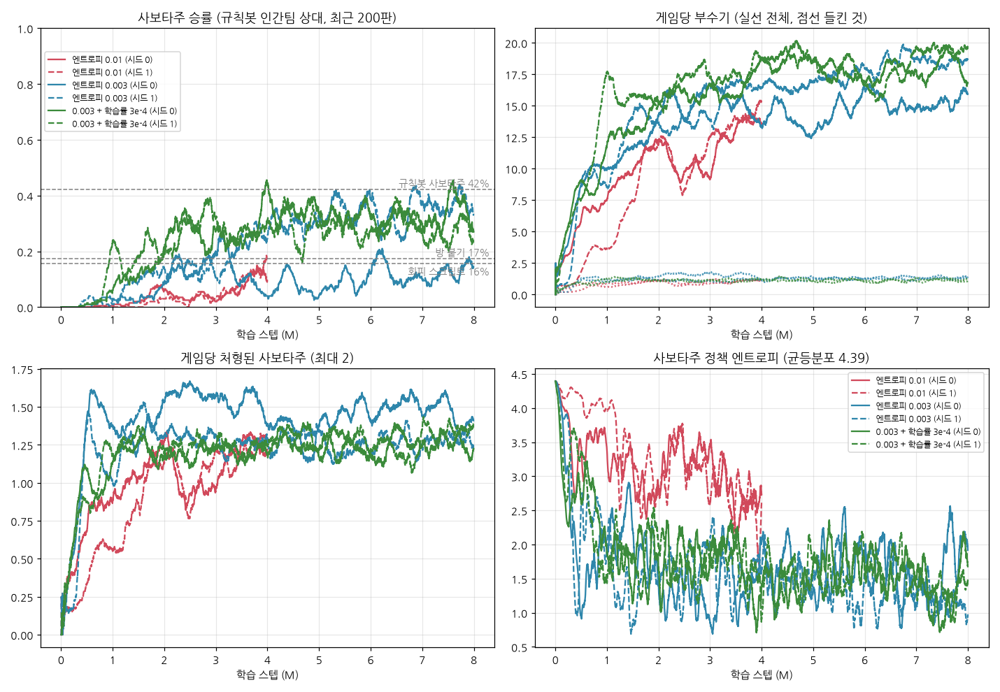

# 사보타주 vs 규칙봇 인간팀

공동 학습(두 팀 동시 학습)에서 인간팀 정책이 끝까지 무작위와 구분되지 않았다(`../replay/REPORT.md`). 그래서 방향을 바꿨다.

- 인간팀(선원 3 + 함장 1)은 규칙봇으로 고정한다.
- 사보타주 2명만 MAPPO로 학습해 규칙봇 인간팀을 이기게 한다.

진행 순서는 다섯 단계다.
1. 규칙봇 인간팀 강화
2. 밸런스 재조정
3. 학습
4. 평가
5. Unity 반영과 정리

## 요약

| | 규칙봇 인간팀 상대 사보타주 승률 |
|---|---|
| 무작위 | 0% |
| 방 붙기 스크립트 (가장 가까운 방에서 계속 부수기) | 17% |
| 회피 스크립트 (인간팀이 보이면 부수지 않음) | 16% |
| **규칙봇 사보타주** (회피형 + 인간팀 위치를 다 아는 특권) | **42%** |
| **학습 사보타주** (`models/saboteur_vs_bot_8M.pt`, 자기 시야만 봄) | **41%** |

(500판씩. 학습 사보타주는 학습에 쓰지 않은 시드로 다시 잰 값이다. 리플레이용으로 다른 시드에서 500판을 더 돌렸을 때는 학습 41%, 규칙봇 39%였다.)

리플레이 뷰어: `replay/replay.html` (브라우저로 열면 된다. 학습 / 규칙봇 / 무작위 사보타주 각 4판)

- 학습 사보타주는 스크립트 전략을 크게 넘었다. 사람이 짠 최선의 규칙봇과는 **동률**이다.
  - 규칙봇 사보타주는 인간팀 전원의 위치를 안다.
  - 학습 사보타주는 시야 10 안만 본다.
- 학습하지 않은 인간팀 상대로는 결과가 섞인다.
  - 이전 규칙봇(bot_level 0): 학습 사보타주 79%, 규칙봇 사보타주 43%
  - 공동 학습 때의 학습 인간팀: 학습 사보타주 75%, 규칙봇 사보타주 87%
- 시드 차이가 크다. 같은 설정 두 시드가 41% / 16%였다.
  - 엔트로피 계수를 낮추지 않으면(0.01) 4M에서 6~12%에 그친다.

## 1. 규칙봇 인간팀 강화 (`bot_level 1`)

이전 봇의 약점은 세 가지였다.
- 알림(안정도 70% 이하)이 떠야만 손상을 알았다.
- 이동 중에는 목적지를 바꾸지 않았다.
- 함장은 근거가 있어도 대상을 쫓지 않았다.

그래서 5줄짜리 방 붙기 스크립트가 56%를 이겼다.

| 기능 | 내용 |
|---|---|
| 공유 정보 | 인간팀 누군가의 시야(vision_range) 안에 있거나 알림이 뜬 방의 안정도를 팀 전체가 안다 (0.1초마다 갱신) |
| 손상 대응 | 알고 있는 손상 방 중 (필요량 / 거리 / 2^이미 가는 사람 수)가 가장 큰 방으로 간다 |
| 순찰 | 손상 방이 없으면 오래 안 본 방, 가까운 방, 아무도 안 가는 방 순으로 확률적으로 고른다 |
| 이동 중 재지정 | 아무도 맡지 않은 손상 방이 생기면, 가장 가까운 한가한 인간팀이 방향을 바꾼다 (0.2초마다) |
| 함장 추적 | 근거(직접 목격·신고)가 있는 대상을 쫓아가 사거리 안에서 쏜다 |
| 자동 수리 | 손상 방 근처에서 자동 수리·끊기 (ML 인간팀과 같은 규칙) |

사보타주 규칙봇도 회피형으로 바꿨다.
- 동료와 다른 방 가운데, 반경 25 안 인간팀이 가장 적고 가까운 방을 노린다.
- 시야에 인간팀이 보이면 부수지 않고 다른 방으로 간다.
- 위치 정보는 전지적이다. 이것은 규칙봇의 특권이다.

이전 밸런스 N 기준, 200판씩 사보타주 승률 (`bot_level_compare_N.txt`):

| 사보타주 \ 인간팀 | 이전 봇 (level 0) | 강화 봇 (level 1) |
|---|---|---|
| 무작위 | 0% | 0% |
| 방 붙기 | 56% | 9% |
| 같은 방 붙기 | 19% | 0% |
| 회피 스크립트 | 40% | 8% |
| 규칙봇 사보타주 | 25% (이전 사보타주 봇) | 16% (회피형 봇) |

## 2. 밸런스 재조정

목표는 두 가지였다.
- 스크립트 전략은 20~30% 아래로 떨어뜨린다.
- 규칙봇 사보타주는 30~40%가 되게 한다. 사람이 짠 전략의 기준선이다.

강화 봇은 너무 강해서 밸런스 N에서는 모든 전략이 16% 이하였다.

- 격자 g2(`grid_g2.jsonl`, 24개 조합 × 5개 전략 × 60판): 부수기 피해 8/9/10, 시야 10/12, 총알 1/2, 알림 60/70, 사거리 15.
- 후보 3개를 200판으로 다시 쟀다(`verify_candidates.txt`). 그중 **B**를 골랐다.

| 항목 | N (이전) | **새 값** |
|---|---|---|
| `sabotage_damage` | 7 | **8** |
| `vision_range` | 12 | **10** |
| `alert_threshold` | 70 | **60** |
| `shoot_range` | 25 | **15** |
| `bot_level` | (0) | **1** |
| `bot_team` | 0 | **2** (인간팀 고정) |

최종 사다리 (500판, `ladder_final.txt`):

| 사보타주 | 승률 | 부수기/판 | 처형된 사보타주/판 | 끝: 방 파괴 / 처형 / 도착 |
|---|---|---|---|---|
| 무작위 | 0% | 1.1 | 0.16 | 0 / 3 / 497 |
| 방 붙기 | 17% | 16.3 | 1.34 | 87 / 215 / 198 |
| 같은 방 붙기 | 4% | 9.0 | 1.56 | 21 / 365 / 114 |
| 회피 스크립트 | 16% | 14.6 | 0.98 | 78 / 115 / 307 |
| 규칙봇 사보타주 | 42% | 24.4 | 1.31 | 211 / 205 / 84 |

## 3. 학습

- 사보타주만 학습하고, 인간팀 데이터는 모으지 않는다. 트레이너가 yaml의 `bot_team: 2`를 읽는다.
- 보상은 이전과 같고 셰이핑은 없다. 승패 ±5, 들키지 않은 부수기 +1, 평균 안정도 변화.

| 실험 | 사보타주 엔트로피 계수 | Actor 학습률 | 길이 | 시드별 마지막 500판 승률 (학습 중) |
|---|---|---|---|---|
| A | 0.01 (기본) | 1e-4 | 4M | 11% / 14% |
| B | **0.003** | 1e-4 | 8M (4M에서 이어서) | 13% / **37%** |
| C | 0.003 | 3e-4 | 8M (4M에서 이어서) | 34% / 27% |

- **엔트로피 계수가 결정적이었다.** A는 엔트로피가 2.6~2.9에 머물러, 정해진 방을 꾸준히 부수는 행동이 늦게 굳었다.
- C(학습률 3배)는 초반이 빠르다. 2M에 25~35%였지만 4M 이후 30% 근처에서 멈췄다.
- B 시드 1은 5M 이후 35~45%까지 올라갔다. 시드 0은 15% 근처에 머물렀다.

학습에 쓰지 않은 시드로 다시 잰 값(기본 봇, 500판): B 41% / 16%, C 33% / 21%.
4M 시점에서는 A 6% / 12%, C 40% / 33%였다(300판).
**최종 모델은 B 시드 1, 7.9M 스텝**이다.

## 4. 평가 (`models/saboteur_vs_bot_8M.pt`, 300판씩, 평가 시드 4242)

| 인간팀 | 학습 사보타주 | 규칙봇 사보타주 |
|---|---|---|
| 기본 강화 봇 (학습 상대) | 40% | 40% |
| 방 상태를 아는 거리 0.7배 | 40% | 37% |
| 방 상태를 아는 거리 1.5배 | 47% | 34% |
| 대응 3초 지연 | 43% | 50% |
| 함장 추적 없음 | 41% | 34% |
| **이전 봇 (bot_level 0)** | **79%** | 43% |
| **공동 학습 때의 학습 인간팀** (`sim_balance_v4_4M_seed2.pt`) | 75% | **87%** |

- 봇 변형에서는 모두 40~47%다. 학습 상대의 특정 설정에만 맞춰진 것이 아니다.
- 이전 봇에서는 크게 이긴다.
  - 이전 봇은 이동 중에 반응하지 않는다. 그래서 한 방을 오래 부수는 전략에 약하다(방 붙기도 56%).
  - 학습 사보타주는 그 약점을 그대로 활용했다.
- 공동 학습 인간팀은 거의 무작위라 둘 다 이긴다. 다만 규칙봇 사보타주가 더 빨리 끝낸다(평균 59초 vs 64초).

기본 봇 상대 행동 비교 (300판):

| | 학습 사보타주 | 규칙봇 사보타주 |
|---|---|---|
| 부수기 / 판 | 19.1 | 23.9 |
| 들킨 부수기 / 판 | 1.2 | 1.6 |
| 수리로 끊긴 부수기 / 판 | 1.7 | 1.1 |
| 처형된 사보타주 / 판 | 1.2 | 1.35 |
| 게임 길이 | 75초 | 74초 |

학습 사보타주는 부수기 횟수가 적다. 대신 들키는 횟수와 처형이 적고, 결과는 같다.

## 5. 반영한 것

- **C#**
  - `GameManager`: `botLevel / botPerception / botReaction / botChase`, 인간팀 공유 정보, env param 연동. 기본값을 새 밸런스로 바꿨다.
  - `NPCAIBrain`: 강화 인간팀 봇, 함장 추적, 회피형 사보타주.
  - `NPCController`: 이동 중 재지정, 도착 규칙, 봇 자동 수리.
  - 씬 값(시야 10, 알림 60, 피해 8).
  - Unity API 스텁으로 컴파일만 확인했다(`tools/csharp_check`).
- **yaml**: `config/TheThing.yaml`(새 설정). 이전 설정은 `config/TheThing_selfplay_v4.yaml`에 남겼다.
- **트레이너** (`mappo_trainer.py`)
  - yaml `bot_team` = 고정 봇 팀. 그 팀의 데이터는 모으지 않고, 평가는 학습하는 팀만 한다.
  - `--entropy-role saboteur=0.003`(역할별 엔트로피 계수), `--balance-yaml`
- **시뮬레이터 도구**
  - `bot_level` 등 파라미터
  - `bot_ladder.py`(전략 사다리), `grid_ladder.py`(격자)
  - `eval_saboteur.py`(변형·학습 인간팀 평가), `plot_saboteur_vs_bot.py`(학습 곡선)
  - `run_trainer.py --entropy-role --lr-actor`

## 한계

- 시뮬레이터는 NavMesh 대신 직선으로 이동한다. 강화 봇의 C# 이식은 컴파일만 확인했고, Unity에서 돌려 보지 않았다.
  - Unity에서 규칙봇끼리 사다리를 다시 재 보는 것이 첫 확인 항목이다.
- 설정당 시드는 2개다. 최종 모델은 6개 실행 가운데 고른 것이라 선택 편향이 있다.
  - 이를 줄이려고 고를 때(시드 777)와 보고할 때(시드 4242) 평가 시드를 나눴다.
- 패배의 대부분은 "들켜서 처형"이다. 처형된 사보타주가 판당 1.2명이다.
  - 사보타주가 동료의 시야를 공유하거나 알림 정보를 더 쓰면 개선될 여지가 있다. 관측 규격이 바뀌는 일이라 이번에는 하지 않았다.
